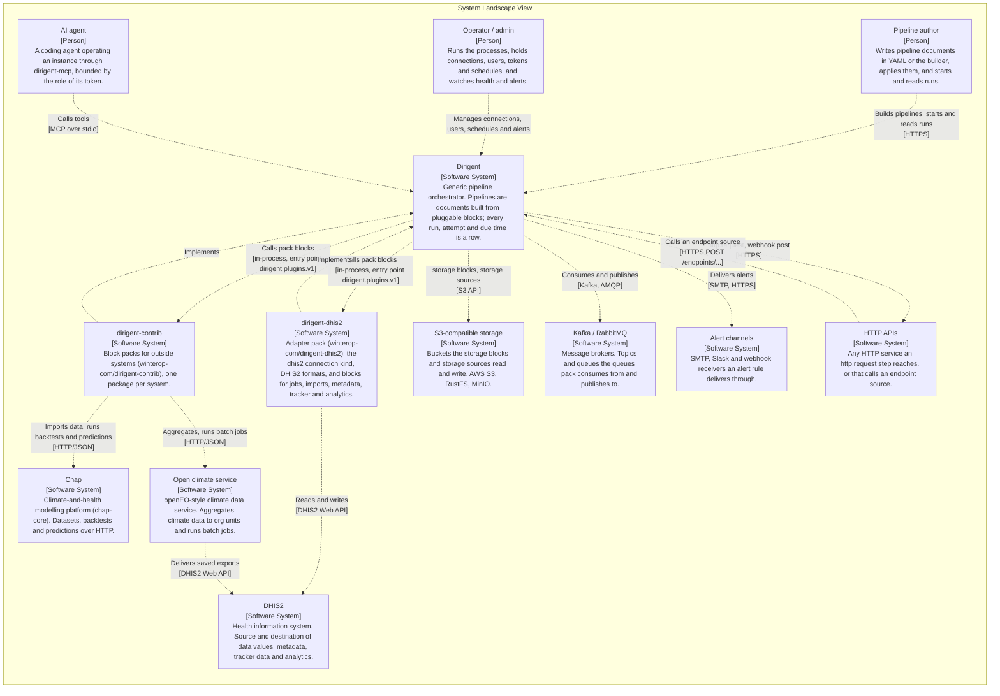
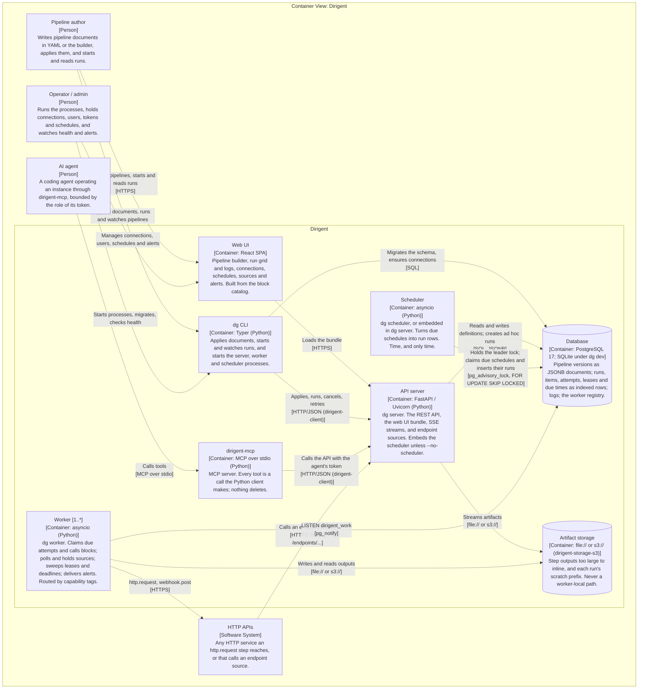
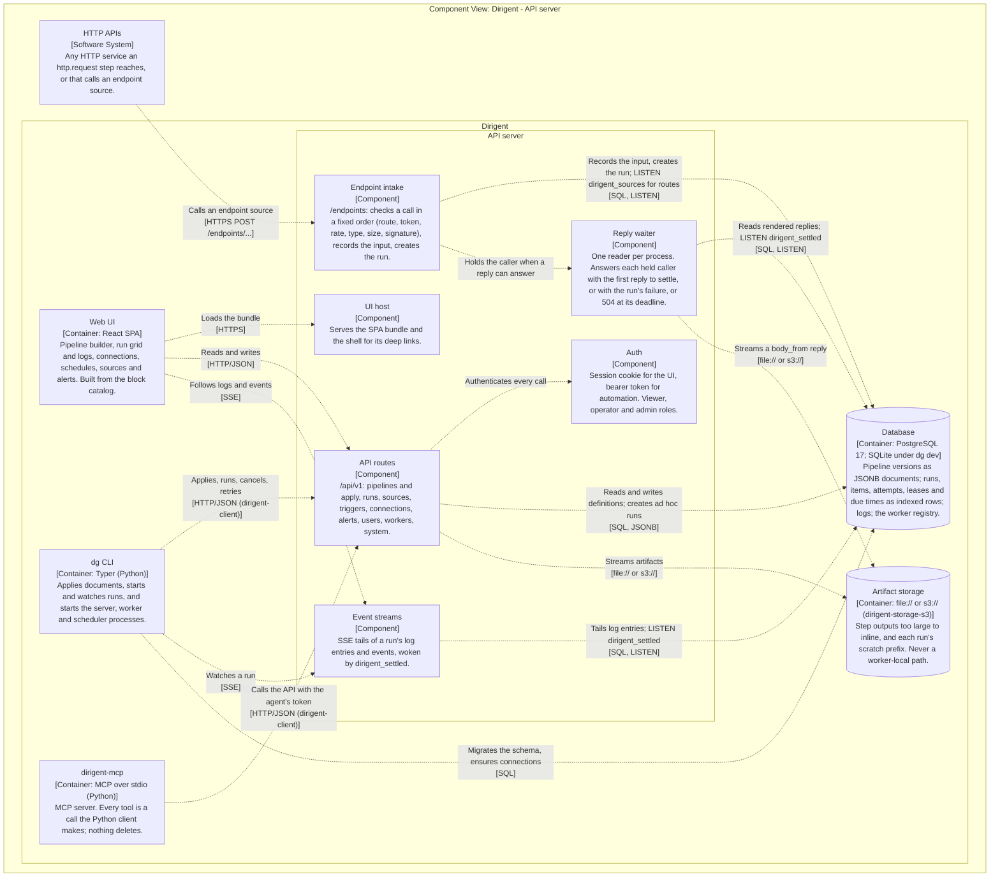
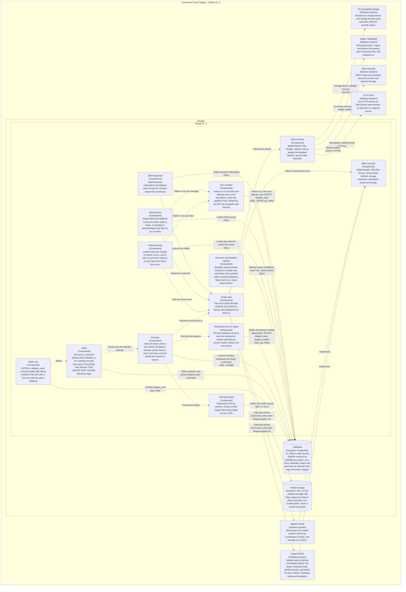
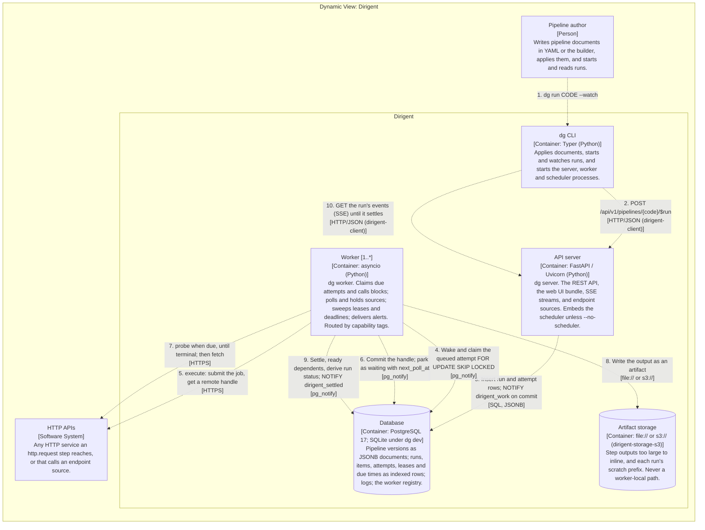
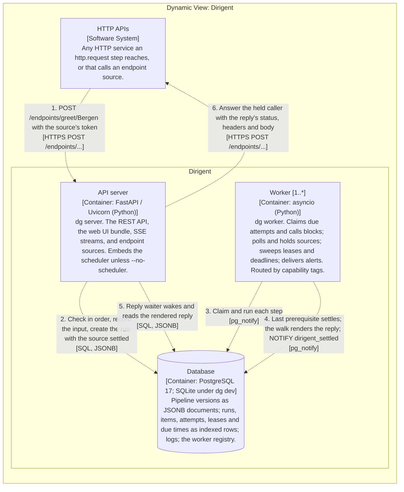
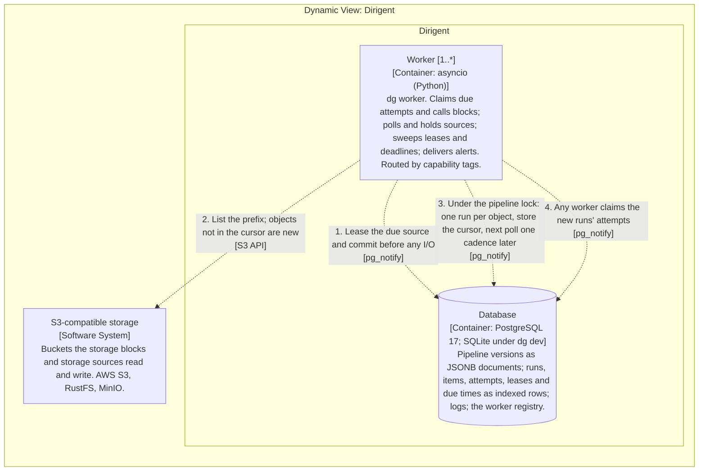
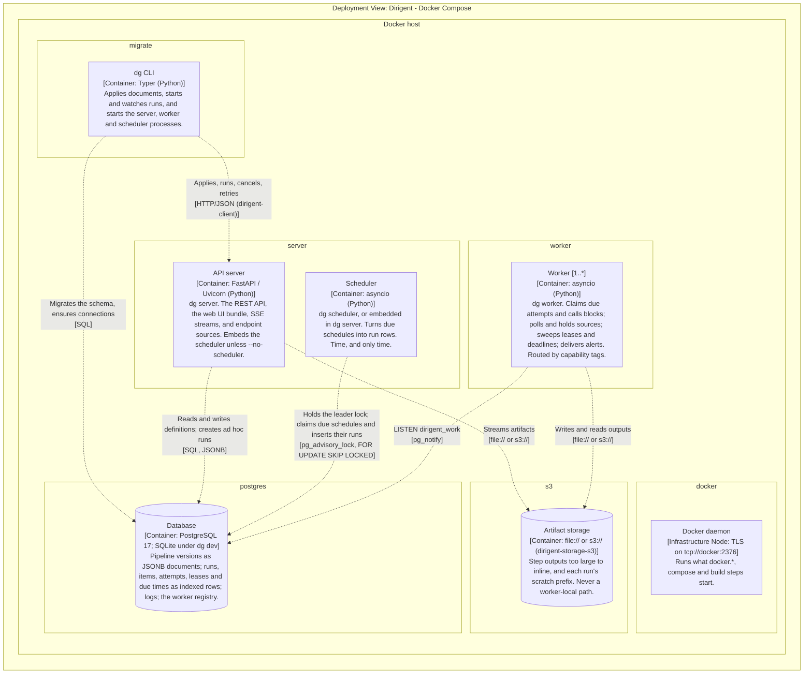
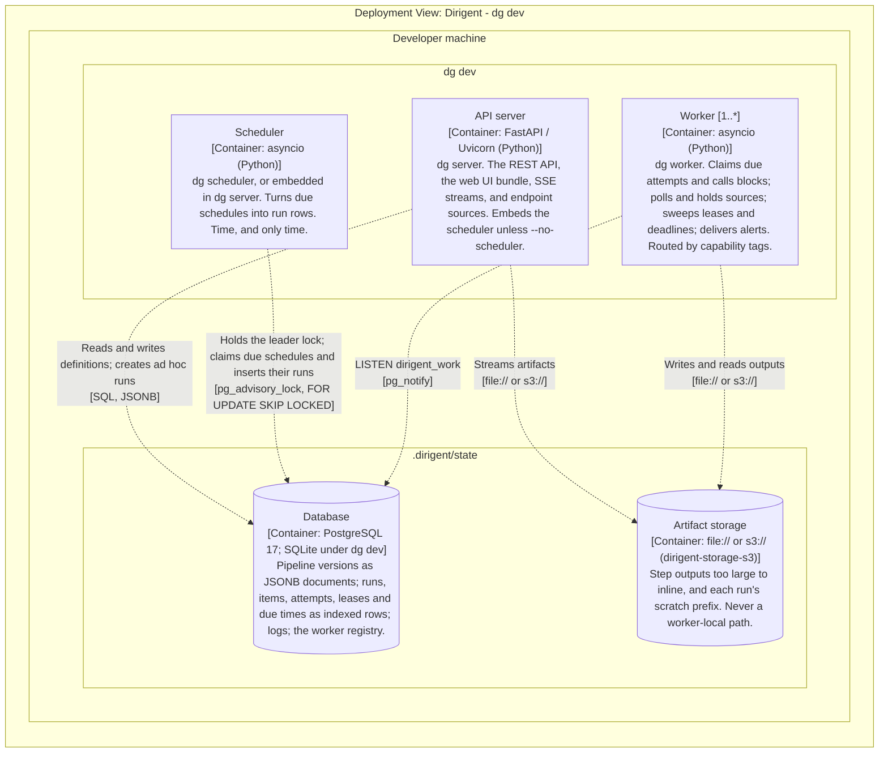

# Architecture model

<!-- GENERATED by `make architecture-export-docs` from architecture/workspace.dsl. Do not edit by hand. -->

A C4 model of Dirigent, generated from the Structurizr model in
`architecture/workspace.dsl`. Every box is labelled with its type. For the interactive
viewer, with zoom and click-through between levels, see `architecture/README.md`.

What each package is for, and what may depend on what, is on
[the architecture page](architecture.md).

## L1 - System landscape

## L2 - Containers: Dirigent

## L3 - Components: API server

## L3 - Components: engine and worker

## Flow - An ad hoc run

## Flow - An endpoint source with a reply

## Flow - A polled source

## Deployment - Docker Compose

## Deployment - dg dev

